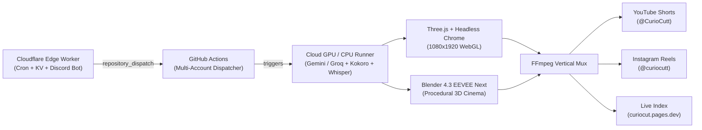

<div align="center">


# CurioCut

**Autonomous Short-Form Video Studio & Live Open-Source Resource Index**

<p>
  <a href="https://curiocut.pages.dev">
    
  </a>
  <br />
  <a href="https://www.youtube.com/@CurioCutt">
    
  </a>
  <a href="https://instagram.com/curiocutt">
    
  </a>
</p>

<p>
  
  
  
  
  
  
</p>

<br/>

*CurioCut researches trending stories and open-source developer tools, writes conversational scripts, renders 3D scenes, synthesizes dual-speaker neural audio, aligns word-level captions, publishes vertical shorts to **YouTube Shorts** and **Instagram Reels**, and indexes every tool live at **[curiocut.pages.dev](https://curiocut.pages.dev)** — at **$0 monthly cloud cost**.*

</div>

---

## Where to Watch & Browse

| Platform | Link | What's There |
|---|---|---|
| **Resource Index** | **[curiocut.pages.dev](https://curiocut.pages.dev)** | Every AI agent, Claude skill, and open-source repo featured in our videos — with 1-click setup prompts, `git clone` commands, and video links |
| **YouTube Shorts** | **[youtube.com/@CurioCutt](https://www.youtube.com/@CurioCutt)** | Daily 3D tech breakdowns, AI tools, and original animated stories |
| **Instagram Reels** | **[instagram.com/curiocutt](https://instagram.com/curiocutt)** | Daily Reels with automated keyword-to-DM resource delivery |

---

## Highlights

- **Zero-Cost Serverless Stack**: Orchestrated across Cloudflare Workers, Cloudflare KV, Cloudflare Pages, GitHub Actions, and cloud GPU runners with automated multi-account failover.
- **Live Resource Hub (`web/`)**: React 18 + Vite 6 + Three.js dot-matrix WebGL web app synced directly to edge KV (`/api/vault`) with `⌘K` search, category tabs, setup prompts, and offline caching.
- **Dual 3D Render Engines**: Headless Three.js/Chrome WebGL (with automatic SwiftShader CPU fallback) for studio dialogues + Headless Blender 4.3 (EEVEE Next, surfaceless EGL) for procedural 3D cinema.
- **Dual-Speaker Neural Audio**: Kokoro ONNX TTS (`am_fenrir` & `af_bella`) paired with acoustic trimming, phonetic tech normalization, and `faster-whisper` word-level kinetic captions.
- **End-to-End Multi-Platform Publishing**: Automated publishing to YouTube Shorts (with description links & first comments) and Instagram Reels, plus real-time Discord observability.

---

## Architecture



---

## Live Resource Index (`web/`)

Built with React 18, Vite 6, Three.js, GSAP, and Framer Motion, hosted at **[curiocut.pages.dev](https://curiocut.pages.dev)**:

- **3D Dot-Matrix Background**: Pointer- and scroll-reactive Three.js particle field.
- **Smart Discovery**: Category tabs (`All Drops`, `Claude Skills`, `AI Agents`, `Open Source`), `⌘K` Command Palette, and paginated grid (`Show More`).
- **Developer Setup Drawer**: 1-click **AI Agent Setup Prompt** (Claude / Cursor / Antigravity), `git clone` command copy, and direct links to the repository, Instagram Reel, and YouTube Short.
- **Resilient Edge Sync**: Automatic `localStorage` fallback with cause-specific offline/server banners, rate-limited refresh, and real-time analytics via Cloudflare KV + Microsoft Clarity.

---

## Creative Animation Suites

| Style | Engine | Focus |
|---|---|---|
| **`town-rule`** | Blender 4.3 EEVEE | Procedural 3D worlds, custom facial decal rigs, and rule-based suspense stories (`town_rule/`). |
| **`claude-desk`** | Three.js / WebGL | Dual-bot cyber workstation breaking down Claude Code skills, MCP servers, and AI workflows. |
| **`dev-studio`** | Three.js / WebGL | Night developer loft with seated DevGuy & floating mascot exploring open-source GitHub tools. |
| **`deep-dive`** | Three.js / WebGL | 3D medical, anatomy, and science cross-section explainers. |
| **`tall-tale`** | Three.js / WebGL | Cartoon 3D town stories covering bizarre real-life loopholes and heists. |
| **`night-file`** | Three.js / WebGL | Noir investigative corridors, evidence boards, and mystery case files. |
| **`paper-atlas`** | Three.js / WebGL | Cut-paper parchment maps and historical turning points. |
| **`inside-out` / `stick-story`** | Three.js / WebGL | Modular 3D/2D narrative suites under `faceless-shorts-skill/`. |

---

## Project Structure

```text
CurioCut/
├── web/                        # CurioCut Index frontend (React + Vite + Three.js -> Cloudflare Pages)
├── cloudflare/
│   ├── worker.js               # Edge cron dispatcher, Discord bot, /api/vault, /api/track, /api/stats
│   └── wrangler.toml           # Worker KV bindings & cron triggers
├── town_rule/                  # Blender 4.3 EEVEE procedural 3D story engine
├── faceless-shorts-skill/      # Three.js WebGL style templates & capture.mjs
├── make_short.py               # End-to-end orchestrator (harvest -> script -> TTS -> render -> upload)
├── trigger_kaggle.py           # Cloud dispatcher, multi-account failover, & health monitor
├── kaggle_worker.py            # Cloud container bootstrapper & live log streamer
├── youtube_uploader.py         # YouTube Shorts uploader + auto description & first comment
├── instagram_uploader.py       # Instagram Reels uploader + edge KV registration
└── discord_notifier.py         # Discord embeds, live progress, & alert helpers
```

---

<details>
<summary><strong>Local Development & Quickstart</strong> (click to expand)</summary>

### Prerequisites
- Python 3.11+
- Node.js 18+ (Node 22+ recommended for `capture.mjs`)
- Google Chrome & FFmpeg

### Python Video Pipeline
```bash
git clone https://github.com/shlokkokk/CurioCut.git
cd CurioCut
pip install -r requirements.txt

# Render a fast local preview
python make_short.py --style claude-desk --draft

# Render and publish
python make_short.py --style claude-desk --upload
```

### Web Index (`web/`)
```bash
cd web
npm install
npm run dev      # Local Vite dev server
npm run build    # Production bundle -> web/dist
```

### Environment Variables
Create a `.env` file in the root directory:
```env
GEMINI_API_KEY=your_gemini_api_key
GROQ_API_KEY=your_groq_api_key
INSTAGRAM_ACCOUNT_ID=your_instagram_account_id
INSTAGRAM_ACCESS_TOKEN=your_instagram_token
DISCORD_BOT_TOKEN=your_discord_bot_token
DISCORD_APPLICATION_ID=your_discord_app_id
```
Run `python authenticate_youtube.py` once to generate `youtube_token.json`.

</details>

---

## License

MIT License — see [LICENSE](LICENSE) for details.
